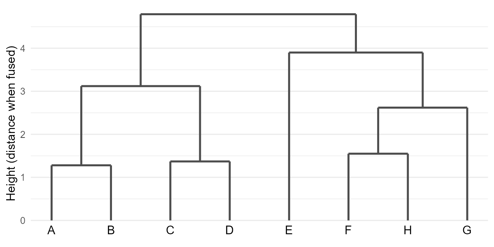

```{r setup, include=FALSE}
knitr::opts_chunk$set(echo = TRUE, warning = FALSE, message = FALSE)
```

### Introduction

Sarah, CloudFit's CEO, has a new kind of question: *"Your models tell me
**who** will cancel. Now I want to know who our members **are**. Are there a
few types of members, so we can build a program for each one?"* There is no
`churn` to predict this time: you are looking for groups in the data itself.

This problem set covers k-means, hierarchical clustering, and principal
component analysis (Days 19–21). Part 4 uses the PCA material from Day 21
(Monday 11/23); the rest you can do after Day 20. Like Problem Sets 3 and 4
it is **conceptual**: you won't fit any models. You'll read output that
CloudFit's analysts produced and explain what it means. It should take about
**45 minutes**, and it's good practice for Midterm 2.

### Instructions

* This problem set is mostly reading tables and output. To see them formatted
  while you work, switch RStudio to **Visual** mode: click **Visual** at the top
  left of the editor (next to **Source**), or press Ctrl+Shift+F4
  (Cmd+Shift+F4 on a Mac). Click **Source** to switch back.
* Write your answers in the space after each question. Short-answer questions
  want 2–4 sentences, not an essay.
* Use the R chunks as a calculator wherever a question asks for a number, so
  your work is visible. Show the formula, not just the result.
* Knit this document before submitting. It should knit without errors, and your
  `.md` output must be visible on GitHub. If I can't see your output, I can't
  grade it.

### The data

The analysts pulled CloudFit's **4,000 paying members** and seven columns that
describe how each one uses the app:

| Variable | Meaning | SD |
|---|---|---|
| `age` | member's age, 18–70 | 9.7 |
| `solo` | workouts the member logs on their own, per week, 0–7 | 2.3 |
| `classes` | live group classes the member joins, per month, 0–20 | 4.1 |
| `friends` | other members the member follows in the app, 0–263 | 50.1 |
| `app_minutes` | average minutes per day spent in the app | 23.2 |
| `premium` | number of premium features the member uses, 0–6 | 1.8 |
| `months` | months the member has been paying | 8.8 |

The data also record whether each member **renewed** their annual plan (60% did).
None of the methods below use `renewed`: it's only used afterwards, to describe
the groups.

Unless a question says otherwise, every method below uses the seven columns
**standardized** (each column minus its mean, divided by its SD), as on
Days 19–21.

---

## Part 1: K-means by Hand (10 minutes)

### Question 1.1: One round of k-means

Six members, and two of the columns:

| Member | `solo` | `classes` |
|---|---|---|
| 1 | 1 | 9 |
| 2 | 2 | 8 |
| 3 | 6 | 1 |
| 4 | 5 | 2 |
| 5 | 1 | 7 |
| 6 | 6 | 0 |

(Both columns are small counts on similar scales, so we skip standardizing
here.) We want $K = 2$ clusters. The random start (Step 1 on Day 19) puts
members **1, 2, and 4** in cluster 1 and members **3, 5, and 6** in cluster 2.
With this start, the total within-cluster variation is $W = 82.67$.

a) Compute the centroid of each cluster.

b) Compute the distance from **member 4** and from **member 5** to each
   centroid. Which cluster does each one move to?

c) Doing the same for all six members, members 1, 2, and 5 end up in one
   cluster and members 3, 4, and 6 in the other. Compute the new centroids and
   the new total within-cluster variation $W$. How does it compare with 82.67?

```{r q1_1}
# Your calculations here

```

*Your answers:*

---

## Part 2: Segmenting the Members (7 minutes)

### Question 2.1: How many clusters?

The analyst ran k-means on all 4,000 members (standardized, `nstart = 20`) for
each $K$ from 1 to 8:

| $K$ | 1 | 2 | 3 | 4 | 5 | 6 | 7 | 8 |
|---|---|---|---|---|---|---|---|---|
| Total within-cluster variation $W$ | 27,993 | 17,982 | 13,274 | 10,282 | 9,514 | 9,015 | 8,673 | 8,339 |

a) Compute how much $W$ falls with each added cluster. Where is the elbow, and
   which $K$ would you pick?

b) $W$ falls every time $K$ goes up. Why can't we just pick the $K$ with the
   smallest $W$? What would $W$ be with $K = 4{,}000$?

```{r q2_1}
# Your calculations here

```

*Your answers:*

### Question 2.2: The four clusters

Here are the averages of each cluster from $K = 4$ (standardized,
`nstart = 20`), in the **original units**, with the share of each cluster that
renewed:

| Cluster | Members | `age` | `solo` | `classes` | `friends` | `app_minutes` | `premium` | `months` | Renewed |
|---|---|---|---|---|---|---|---|---|---|
| 1 | 1,657 | 43.0 | 1.0 | 0.6 | 9.0 | 16.9 | 0.4 | 7.9 | 36% |
| 2 | 757 | 28.8 | 1.2 | 9.0 | 112.2 | 40.5 | 1.7 | 13.0 | 69% |
| 3 | 579 | 32.9 | 4.7 | 8.0 | 91.7 | 74.5 | 4.4 | 26.6 | 91% |
| 4 | 1,007 | 39.0 | 4.9 | 1.0 | 12.7 | 46.3 | 2.6 | 19.2 | 77% |

a) Give each cluster a short name and explain it, using two or three columns
   for each.

b) Renewal rates differ a lot across clusters, but k-means never saw
   `renewed`. Why can clusters built without `renewed` still differ on it?

c) Sarah can afford one new program, aimed at one cluster, to raise renewals.
   Which cluster would you pick, and what would the program do? Use the table.

*Your answers:*

---

## Part 3: Hierarchical Clustering (8 minutes)

### Question 3.1: Reading a dendrogram

To see the tree up close, the analyst picked eight members:

| Member | `age` | `solo` | `classes` | `friends` | `app_minutes` | `premium` | `months` |
|---|---|---|---|---|---|---|---|
| A | 47 | 2 | 0 | 6 | 15 | 0 | 8 |
| B | 38 | 1 | 0 | 11 | 9 | 1 | 4 |
| C | 38 | 3 | 1 | 4 | 38 | 4 | 23 |
| D | 38 | 4 | 1 | 12 | 23 | 2 | 21 |
| E | 49 | 0 | 8 | 149 | 47 | 1 | 13 |
| F | 29 | 2 | 8 | 72 | 36 | 4 | 23 |
| G | 18 | 2 | 5 | 91 | 78 | 2 | 17 |
| H | 27 | 3 | 6 | 101 | 55 | 3 | 16 |

Using the standardized columns, Euclidean distance, and complete linkage, the
tree is below, drawn the same way as on the Day 20 slides: two branches join at
the **height** where they fused.
The fusion heights are 1.28 (A, B), 1.37 (C, D), 1.55 (F, H), 2.62 (G joins
{F, H}), 3.12 ({A, B} joins {C, D}), 3.90 (E joins {F, G, H}), and 4.79 (the
last fusion).



a) Is member C more similar to A or to E? How can you tell from the tree?

b) G is drawn next to H. Does the tree tell you whether G is more similar to
   H or to F? Explain.

c) Cut the tree at height 3.5. How many clusters do you get, and who is in
   each? Where would you cut to get 4 clusters?

*Your answers:*

### Question 3.2: Linkage

The distances (standardized) from G to F and from G to H are **2.62** and
**1.57**.

a) Compute the distance between G and the group {F, H} with **complete**,
   **single**, and **average** linkage. Which one matches the height where G
   joins {F, H} in the tree?

b) With single linkage, would G join {F, H} at a lower or a higher height?
   Why?

```{r q3_2}
# Your calculations here

```

*Your answers:*

---

## Part 4: Principal Components (10 minutes)

### Question 4.1: How many components?

The analyst ran PCA on the seven standardized columns
(`prcomp(X, scale = TRUE)`):

| | PC1 | PC2 | PC3 | PC4 | PC5 | PC6 | PC7 |
|---|---|---|---|---|---|---|---|
| Proportion of variance | 0.492 | 0.227 | 0.091 | 0.062 | 0.058 | 0.040 | 0.030 |
| Cumulative proportion | 0.492 | 0.719 | 0.810 | 0.872 | 0.929 | 0.970 | 1.000 |

a) Why are there exactly seven components?

b) How much of the variation do PC1 and PC2 keep together? How many
   components do you need to keep 80%?

*Your answers:*

### Question 4.2: Naming the components

The loadings (signs flipped so that a high PC1 means more app time and a high
PC2 means more friends; see "Signs are arbitrary" on Day 21):

| | PC1 | PC2 |
|---|---|---|
| `age` | −0.30 | −0.36 |
| `solo` | 0.29 | −0.54 |
| `classes` | 0.39 | 0.44 |
| `friends` | 0.37 | 0.46 |
| `app_minutes` | 0.46 | −0.16 |
| `premium` | 0.41 | −0.24 |
| `months` | 0.40 | −0.30 |

a) Give PC1 a name. What kind of member has a high PC1 score?

b) PC2 is a trade-off, like "the mix" on Day 21. Which columns push it up,
   and which push it down? Give it a name.

*Your answers:*

### Question 4.3: The clusters on the map

The average PC1 and PC2 scores of each k-means cluster from Question 2.2:

| Cluster | PC1 | PC2 |
|---|---|---|
| 1 | −1.85 | 0.11 |
| 2 | 1.14 | 1.95 |
| 3 | 3.10 | −0.38 |
| 4 | 0.41 | −1.43 |

a) Sketch (or describe) where the four clusters sit on a map of PC1 vs PC2,
   using your names from Question 2.2. Do their positions agree with your names
   for PC1 and PC2?

b) Clusters 2 and 4 are close on PC1. What separates them? Why is it useful
   to plot the first **two** components, not just PC1?

*Your answers:*

### Question 4.4: Forgetting to standardize

The analyst also ran `prcomp(X)` on the **raw** columns. PC1 now keeps
**82.7%** of the variation, and its loadings are:

| `age` | `solo` | `classes` | `friends` | `app_minutes` | `premium` | `months` |
|---|---|---|---|---|---|---|
| −0.09 | 0.00 | 0.06 | 0.96 | 0.24 | 0.01 | 0.06 |

PC1 keeps much more variation than in Question 4.1. Does that make it a
better summary of the members? Explain, using the SDs in "The data".

*Your answers:*

---

## Part 5: Can We Trust the Groups? (5 minutes)

Sarah's marketing director asks: *"With the churn models, we checked the error
on members the model hadn't seen. What's the check here?"*

To find out, the analyst split the members into two random halves of 2,000 and
ran k-means ($K = 4$, standardized, `nstart = 20`) on each half separately.
The cluster averages, in the original units:

**Half 1**

| Cluster | Members | `age` | `solo` | `classes` | `friends` | `app_minutes` | `premium` | `months` |
|---|---|---|---|---|---|---|---|---|
| 2 | 856 | 43.1 | 1.1 | 0.5 | 9.0 | 16.8 | 0.4 | 8.0 |
| 1 | 486 | 39.0 | 4.9 | 1.0 | 12.6 | 46.8 | 2.7 | 19.0 |
| 4 | 298 | 32.8 | 4.6 | 8.1 | 90.6 | 73.9 | 4.4 | 26.9 |
| 3 | 360 | 28.8 | 1.1 | 8.9 | 111.1 | 40.6 | 1.7 | 12.8 |

**Half 2**

| Cluster | Members | `age` | `solo` | `classes` | `friends` | `app_minutes` | `premium` | `months` |
|---|---|---|---|---|---|---|---|---|
| 3 | 804 | 43.0 | 1.0 | 0.6 | 9.1 | 17.1 | 0.4 | 7.9 |
| 2 | 518 | 38.9 | 4.9 | 1.0 | 12.8 | 45.8 | 2.6 | 19.3 |
| 4 | 281 | 33.2 | 4.7 | 7.9 | 92.4 | 75.1 | 4.4 | 26.2 |
| 1 | 397 | 28.7 | 1.2 | 9.0 | 113.3 | 40.4 | 1.6 | 13.4 |

a) Do the two halves find the same four groups as Question 2.2? Match them up.

b) Why is there no test error or CV error for clustering? Explain how this
   two-halves check helps instead, and what you would conclude if the halves
   had found different groups.

*Your answers:*

---

## Part 6: Report to Sarah (5 minutes)

Write a 4–6 sentence summary for Sarah, without technical terms. Include: how
many types of members CloudFit has and what each one is like; which type renews
least, and one idea for it; and why you trust that the types are real.

*Your answer:*
